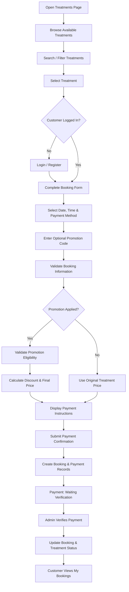
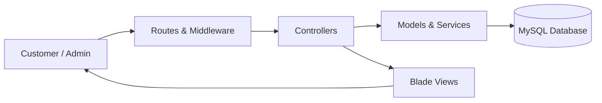

 <div align="center">

# Lumiere Beauty Clinic

### Beauty Treatment Booking & Management System

A web-based beauty clinic application designed to simplify treatment discovery, online reservations, scheduling, and payment simulation through an integrated digital platform.

**Academic Group Project — Web Programming**

[Live Demo](https://lumierebeauty.web.id) · [GitHub Repository](https://github.com/anggitasilmyy/lumiere-beauty)


</div>

---

## Overview

**Lumiere Beauty Clinic** is a web-based beauty treatment booking and management system developed as a group project for the Web Programming course at Universitas Esa Unggul.

The application provides an integrated platform where customers can explore beauty treatments, make online reservations, select appointment schedules, apply promotional discounts, and complete simulated payment procedures.

The system also incorporates customer membership, loyalty points, booking history, and administrative management to support clinic operations.

The application supports three primary user roles:

- **Guest** — Browse treatment information, promotions, and membership details.
- **Customer** — Book treatments, complete payment simulation, access booking history, and manage personal information.
- **Administrator** — Manage treatments, bookings, payments, promotions, and treatment statuses.

---

## My Contribution

**Neng Audy Agustin**

My contribution to this project focused on three main modules: **Treatments, Treatment Booking, and Booking Flow**.

### 1. Treatments

Contributed to the development of the customer-facing treatment catalogue, allowing customers to explore available beauty services.

Key implementations:

- Display active treatments dynamically from the MySQL database.
- Present treatment information, including category, image, name, description, duration, and price.
- Implement treatment search functionality.
- Implement category-based filtering.
- Provide pagination to organize treatment listings.
- Enable customers to select a treatment and proceed to the booking form.

### 2. Treatment Booking

Contributed to the treatment reservation form and its integration with the application workflow.

Key implementations:

- Allow customers to select their preferred treatment.
- Provide booking date and time selection.
- Implement payment method selection.
- Support optional promotional codes.
- Provide an additional notes field for booking information.
- Implement server-side validation for booking inputs.
- Restrict booking access to authenticated customers.

**Booking validation rules:**

| Field | Validation |
|---|---|
| Treatment | Must be an available treatment |
| Booking Date | Today or a future date |
| Booking Time | 09:00–20:00, in 30-minute intervals |
| Payment Method | QRIS, Bank Transfer, E-Wallet, or Cash |
| Promotion Code | Optional, maximum 50 characters |
| Notes | Optional, maximum 1,000 characters |

### 3. Booking Flow

Contributed to the integration of the treatment selection, booking, checkout, and payment confirmation workflow.

Key implementations:

- Connect the selected treatment with the booking form.
- Integrate promotion validation into the booking process.
- Calculate the original price, discount amount, and final payment amount.
- Implement a temporary checkout session before payment confirmation.
- Display payment instructions based on the selected payment method.
- Generate unique booking and transaction codes.
- Save booking and payment records using database transactions.
- Initialize booking and payment statuses for subsequent administrator verification.

The booking process also integrates promotion requirements, including promotion availability, eligible treatments, validity periods, and minimum membership levels.

**Initial transaction statuses:**

| Component | Initial Status |
|---|---|
| Payment Status | Waiting Verification |
| Booking Status | Pending |
| Treatment Status | Not Started |

The customer can subsequently monitor booking information and transaction statuses through the My Bookings page.

### Relevant Implementation Files

The following files are related to the modules covered by my contribution:

```text
app/
├── Http/
│   └── Controllers/
│       ├── TreatmentController.php
│       ├── CheckoutController.php
│       └── BookingController.php
│
├── Models/
│   ├── Treatment.php
│   ├── Booking.php
│   └── Payment.php
│
└── Services/
    └── PaymentChannelService.php

resources/
└── views/
    ├── treatments/
    │   └── index.blade.php
    │
    ├── checkout/
    │   └── payment.blade.php
    │
    └── bookings/
        └── my-bookings.blade.php

routes/
└── web.php
```

---

## Key Features

The following features represent the overall capabilities of the group-developed application.

- **Treatment Catalogue** — Browse, search, and filter available beauty treatments.
- **Online Treatment Booking** — Select treatments, appointment dates, times, and payment methods.
- **Promotion Integration** — Apply eligible promotional codes with automatic discount calculations.
- **Simulated Payment** — Supports QRIS, bank transfer, e-wallet, and cash payment workflows.
- **Booking Management** — Monitor booking, payment, and treatment statuses.
- **Membership System** — Supports Bronze, Silver, Gold, and Platinum membership levels.
- **Loyalty Points** — Track accumulated points and transaction history.
- **Customer Profile** — Manage customer information and membership details.
- **Payment Receipt** — Provide payment receipts for eligible verified transactions.
- **Customer Reviews** — Support customer feedback through treatment reviews.
- **Admin Dashboard** — Manage treatment information, bookings, payment verification, and promotions.

---

## Core Business Flow

The following diagram illustrates the treatment selection and booking workflow.



**Booking workflow:** Treatment selection → Booking details → Validation → Checkout → Payment confirmation → Admin verification → Booking tracking.

---

## System Architecture

Lumiere Beauty Clinic implements the **Model-View-Controller (MVC)** architectural pattern provided by Laravel.



The architecture separates application responsibilities:

- **Model:** Manages database records and relationships.
- **View:** Displays application interfaces using Laravel Blade.
- **Controller:** Handles requests, validation, and application logic.
- **Service:** Handles reusable business logic, including payment channels and promotion calculations.
- **Middleware:** Controls authentication and administrator access.

---

## Technology Stack

| Category | Technology |
|---|---|
| Backend Framework | Laravel 10 |
| Programming Language | PHP 8.1 |
| Frontend Template | Laravel Blade |
| Frontend | HTML, CSS, JavaScript |
| UI Framework | Bootstrap 5.3 |
| Database | MySQL |
| ORM | Laravel Eloquent |
| Asset Bundler | Vite |
| Dependency Management | Composer & NPM |
| Local Development | XAMPP / Localhost |
| Version Control | Git & GitHub |
| Hosting | DomaiNesia |
 
---

## Database Overview

The application uses a relational MySQL database to manage customer information, treatments, bookings, payments, and other application data.

| Table | Purpose |
|---|---|
| users | Customer and administrator accounts |
| treatments | Treatment information, prices, and availability |
| bookings | Customer treatment reservations and booking statuses |
| payments | Payment transactions and verification statuses |
| promotions | Promotional campaigns and discount information |
| membership_levels | Customer membership levels |
| point_transactions | Loyalty point transaction records |
| reviews | Customer reviews |
| roles | Application user roles |
| role_user | User and role relationships |

The database relationships are managed using Laravel Eloquent ORM.

---

## Testing

The application was evaluated using **Black-Box Testing** to verify whether the implemented features produced the expected outputs.

The final project report documents successful test scenarios for:

- Treatment catalogue display.
- Customer registration and login.
- Treatment selection and booking submission.
- Payment simulation and confirmation.
- Customer booking history.
- Membership and loyalty points.
- Administrator dashboard.
- Promotion management.
- HTTPS accessibility.

The tested functions produced results consistent with their respective test scenarios.

---

## Getting Started

### Requirements

Make sure the following software is installed:

- PHP 8.1 or later
- Composer
- MySQL
- Node.js and NPM
- Git

### 1. Clone Repository

```bash
git clone https://github.com/audyyagustin/lumiere-beauty.git
cd lumiere-beauty
```

### 2. Install Dependencies

```bash
composer install
npm install
```

### 3. Configure Environment

Create a local environment file.

**Windows:**

```bash
copy .env.example .env
```

**macOS / Linux:**

```bash
cp .env.example .env
```

### 4. Generate Application Key

```bash
php artisan key:generate
```

### 5. Configure Database

Configure the MySQL connection in the `.env` file.

Example:

```env
DB_CONNECTION=mysql
DB_HOST=127.0.0.1
DB_PORT=3306
DB_DATABASE=lumiere_beauty
DB_USERNAME=root
DB_PASSWORD=
```

### 6. Run Database Migration and Seeders

```bash
php artisan migrate --seed
```

The available seeders initialize membership levels, roles, administrator data, treatments, and promotions.

### 7. Create Storage Link

```bash
php artisan storage:link
```

### 8. Build Frontend Assets

```bash
npm run build
```

### 9. Start Laravel Development Server

```bash
php artisan serve
```

The application can normally be accessed at:

```text
http://127.0.0.1:8000
```

For frontend development, run `npm run dev` in a separate terminal.

---

## Project Limitations

The current application was developed for academic demonstration and has several limitations that can be improved in future development.

- Payment processing is simulated and is not connected to a real payment gateway.
- Payment verification still requires administrator involvement.
- Booking schedule conflict and appointment capacity validation can be improved.
- Payment proof upload requires further validation and security improvements.
- Additional security auditing, backup mechanisms, and application monitoring are recommended.

These limitations provide opportunities for future system enhancement.

---

## Project Team

Lumiere Beauty Clinic was developed collaboratively by Group 10 for the Web Programming course.

| Team Member | Main Contribution |
|---|---|
| Silmy Kaffa Anggita | Home Page and Interface Integration |
| **Neng Audy Agustin** | **Treatments, Treatment Booking & Booking Flow** |
| Angellica Ivana | Membership, Points, Profile & Membership Levels |
| Stefanie Sentana | Promotions & Promotion Management |
| Nova Selvia | Contact & Clinic Information |

---

## Deployment

The application was deployed using **DomaiNesia Hosting** with the following configuration:

- Hosting: DomaiNesia
- Domain: [lumierebeauty.web.id](https://lumierebeauty.web.id)
- Backend: Laravel 10
- Database: MySQL
- Web Protocol: HTTPS with SSL

The deployment was documented as part of the academic project. Current public availability may vary.

---

## Project Information

**Course:** CSF412 – Web Programming  
**Institution:** Universitas Esa Unggul  
**Study Program:** Information Systems  
**Class:** KJ001  
**Academic Year:** 2025/2026  
**Project:** Group 10 – Lumiere Beauty Clinic

This project was developed collaboratively as an academic implementation of web programming concepts, including Laravel MVC, database management, dynamic web interfaces, online booking workflows, and web deployment.

<div align="center">

---

### Lumiere Beauty Clinic

**Beauty Treatment Booking & Management System**

*Developed as an Academic Group Project*

</div>
